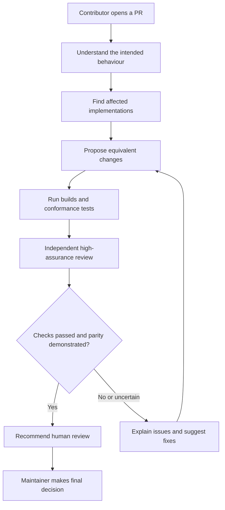

<div align="center">

<a href="https://www.quorumtech.ch">
  <picture>
    <source media="(prefers-color-scheme: dark)" srcset="assets/quorum-lettermark-dark.svg">
    <source media="(prefers-color-scheme: light)" srcset="assets/quorum-lettermark-light.svg">
    
  </picture>
</a>

<br />

# Polyglot PR Bot

### Contribute in the language you love. We'll help with the rest.

An open-source GitHub bot that helps people contribute across programming languages, without expecting everyone to know them all.

[](LICENSE)
[](https://github.com/vihanga-w/polyglot-pr-bot)

**Built by [Quorum Technologies](https://www.quorumtech.ch). Open to everyone.**

</div>

---

## Good ideas shouldn't depend on which language you know.

Imagine you spot a bug in a Rust library, but you only know Python. You understand the problem. You know how to fix it. The language just gets in the way.

**We want to change that.**

Polyglot PR Bot aims to let you express a change in the language you're comfortable with, then help translate, test, and review it for the language the project actually uses.

For projects with several language implementations, it can help carry the same behaviour across every copy.

You bring the idea and the code you know how to write. The bot handles the repetitive cross-language work and explains what it changed. Maintainers still decide what gets merged.

> **Example:** A contributor writes a Python test and reference fix for a bug in a C library. The bot uses that as a behavioural guide, proposes a native C patch, checks it against the project's tests and conventions, and sends it for human review.
>
> The final contribution is C, even though the contributor started in Python.

## Two ways to contribute

| If you're working on... | We'd like you to be able to... |
| --- | --- |
| **A project implemented in several languages** | Fix the version you know, then let the bot find and propose corresponding changes in the others. |
| **A project written in a language you don't know** | Submit a reference implementation or test in a familiar language, then review the proposed native-language patch. |

The second workflow is a goal, not magic automatic translation.

Some changes depend on memory models, operating systems, concurrency, performance, or platform APIs. In those cases, the bot should explain the tradeoffs and ask for help rather than pretend the languages are interchangeable.

## How a contribution moves forward



### 1. Start where you're comfortable

Open a pull request in a supported language, or provide a reference example for the behaviour you want.

You shouldn't have to learn an entirely new language just to contribute a good idea.

### 2. Find the affected code

The bot identifies related implementations, APIs, and tests, including code the pull request didn't touch.

### 3. Propose the missing work

It prepares idiomatic changes for other languages while preserving the intended behaviour.

The goal is functional equivalence, not identical syntax.

### 4. Check the result

Builds, shared conformance tests, language-specific tests, and regression checks run wherever possible.

When exact equivalence isn't possible, differences are documented rather than hidden.

### 5. Independent final review

A separate high-assurance review layer, configurable to use models such as Fable or Astra where available, examines:

- Correctness and behavioural parity
- Potential security vulnerabilities
- Unintended changes and regressions
- Language-specific memory and concurrency risks
- Compatibility with existing APIs
- Test coverage and unresolved assumptions

This reviewer should be independent of the agent that generated the changes.

**A passing AI review is not a guarantee that code is vulnerability-free.** If the evidence is insufficient, the bot should report that honestly instead of recommending a merge.

### 6. Human review

Once the required checks pass, the bot can recommend the pull request for human review.

Maintainers always make the final decision.

**The bot helps people contribute. It doesn't replace maintainers.**

## Ask the bot what happened

Generated changes shouldn't be a mystery.

Sometimes you just want to understand what a pull request does without reading every line of code.

That's what `/explain` is for.

### Get a simple explanation

Comment on a pull request:

```text
/explain
```

The bot will aim to explain, in plain English:

- What the contributor changed
- What problem the change solves
- Which other languages were affected
- What the bot generated or modified
- Which tests passed or failed
- Whether anything still needs human attention

### Ask a specific question

```text
/explain Why does the Rust version return a Result instead of throwing?
```

Or:

```text
/explain Could this change affect memory safety in the C implementation?
```

The bot should answer using the actual pull request, its changes, and available test results.

If it doesn't have enough information, it should say so.

### Planned commands

```text
/explain
/explain <question>

/parity
/parity --fix

/review
/improve
```

`/review` and `/improve` are inherited PR-Agent capabilities.

`/parity` is available: it reports which language implementations a PR did not update, where the equivalent change belongs in each, and performance and distribution opportunities in the changed code. See [docs/docs/tools/parity.md](docs/docs/tools/parity.md). `/parity --fix` and `/explain` are planned and not yet implemented.

## What we're building

| Capability | Status |
| --- | --- |
| General AI pull request review | Inherited from PR-Agent |
| AI code improvement suggestions | Inherited from PR-Agent |
| Configurable AI models and self-hosting | Inherited from PR-Agent |
| Cross-language code discovery | Available (`/parity`) |
| Contributions using a familiar-language reference | Planned |
| Automatic native-language change proposals | Planned |
| Shared behavioural and conformance testing | Planned |
| Cross-language parity analysis | In progress (`/parity` marks each implementation needs change, not applicable or unverified) |
| Independent high-assurance security review | Planned |
| `/explain` with natural-language questions | Planned |
| Evidence-based merge recommendations | Planned |

We're building in public.

This repository began as a fork of the open-source PR-Agent project. Its existing review engine provides the foundation for the cross-language workflows we're developing.

We'd rather be clear about what's available today than promise features before they're ready.

## Getting started

The inherited PR-Agent CLI is available while Polyglot PR Bot's dedicated tools are being developed.

### Requirements

- Python 3.12+
- Git
- Access to a supported AI model provider
- Appropriate repository permissions

### Local installation

```bash
git clone https://github.com/vihanga-w/polyglot-pr-bot.git
cd polyglot-pr-bot

python -m pip install -e '.[github]'

export OPENAI_KEY='your-api-key'

pr-agent --pr_url https://github.com/owner/repo/pull/123 review
```

Replace the example pull request URL with your own.

The `pr-agent` command name is inherited from the upstream project and may change as the fork develops.

For existing commands, provider configuration, and deployment options, see the [upstream PR-Agent documentation](https://docs.pr-agent.ai/).

Some upstream instructions may refer to the original project rather than this fork.

## We'd love your help

**You don't need to know every programming language to contribute here either.**

Whether you're experienced with compilers, enjoy writing tests, or have encountered a frustrating cross-language bug, we'd love to hear from you.

We're particularly interested in:

- Finding equivalent functions across languages
- Detecting behavioural differences
- Building shared conformance tests
- Improving generated code quality
- Designing safe, understandable AI-assisted review workflows
- Making the contribution experience more approachable

You can start with the language you're comfortable with.

Our guiding principle is simple:

**Make contributing easier without making reviewing less trustworthy.**

No silent code changes. No mystery approvals. No expectation that an AI-generated patch must be accepted.

Read [CONTRIBUTING.md](CONTRIBUTING.md), open an issue, or join a discussion.

## Security and privacy

Polyglot PR Bot is intended to support self-hosted deployment.

Code and pull request context may be sent to the AI provider configured by the operator. Review that provider's data-handling policies before using the bot with private repositories.

Automated workflows should:

- Execute untrusted code in isolated environments
- Avoid exposing production credentials to contributor code
- Use narrowly scoped repository permissions
- Require approval for generated changes
- Keep an auditable record of automated modifications
- Distinguish verified results from AI-generated assessments

AI review complements testing, static analysis, and human judgment. It does not replace them.

## License

Polyglot PR Bot is distributed under the [MIT License](LICENSE).

Redistributions and derivative works must preserve all applicable copyright and license notices.

---

<div align="center">

### Made to help more people contribute.

**An open-source project by [Quorum Technologies](https://www.quorumtech.ch).**

</div>

## Acknowledgements

Polyglot PR Bot is based on [PR-Agent](https://github.com/The-PR-Agent/pr-agent), the community-maintained, open-source AI pull request reviewer originally developed by Qodo.

We're grateful to the original authors, maintainers, and contributors for building and sharing the foundation that makes this project possible.

The upstream project is licensed under the MIT License. Its copyright notices and license terms must be preserved in this repository.

Polyglot PR Bot is an independent project developed by Quorum Technologies and is not affiliated with or endorsed by Qodo or the PR-Agent maintainers.
