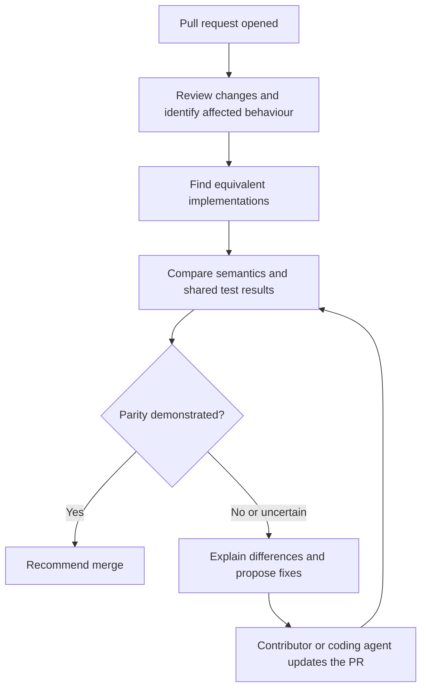

<div align="center">

<sub>AN OPEN-SOURCE PROJECT BY <a href="https://www.quorumtech.ch"><strong>QUORUM TECHNOLOGIES</strong></a></sub>

# Polyglot PR Bot

### One change. Every language.

**AI-assisted pull request reviews for projects that maintain the same behaviour across multiple languages.**

[](LICENSE)
[](https://github.com/vihanga-w/polyglot-pr-bot)

</div>

---

A bug fixed in Python should not quietly survive in Rust. A validation rule added in Go should not get forgotten in TypeScript.

**Polyglot PR Bot** is being built to catch those gaps. It reviews pull requests, finds equivalent code in other languages, and helps contributors carry changes across implementations without having to know every language in the repository.

The goal is simple: **make it easy to contribute in one language without letting the others fall behind.**

> [!IMPORTANT]
> **Project status: early development.** This repository is currently based on the open-source [PR-Agent](https://github.com/The-PR-Agent/pr-agent) review engine. Its existing review tools are available through the inherited codebase. The cross-language parity workflow described below is the project's direction, **not a claim that every feature is implemented today**.

## / Why this exists

Maintaining a polyglot codebase is more than translating syntax. Equivalent implementations need to agree on input validation, edge cases, errors, outputs, and observable behaviour, even when their internal designs differ.

Traditional code review checks the files that changed. **Polyglot PR Bot is designed to also check the implementations that *didn't* change.**

- **Contribute in your language.** Fix the implementation you know best.
- **Find what else is affected.** Locate related code across supported languages.
- **Compare behaviour, not formatting.** Idiomatic implementations should still meet the same contract.
- **Get practical next steps.** Receive suggested changes, test cases, and a ready-to-use prompt for a coding agent.
- **Earn a merge recommendation.** Shared conformance tests and parity review should agree before the bot recommends merging.

## / How it will work



The bot will distinguish between **aligned**, **needs changes**, **not applicable**, and **unverified** implementations. It should not mark a PR as safe simply because an AI model thinks the code looks similar. A merge recommendation requires passing checks and sufficient evidence of equivalent observable behaviour. Human maintainers retain the final decision.

When exact equivalence is not possible because of language or platform differences, the bot will aim for the closest behaviour permitted by the shared specification, clearly document the exception, and require maintainer review rather than silently accepting a mismatch.

## / Capabilities

| Capability | Status |
| --- | --- |
| General-purpose AI review, suggestions and PR questions | Available in the inherited PR-Agent codebase |
| Configurable LLM providers and self-hosted deployment | Available in the inherited PR-Agent codebase |
| Cross-language implementation discovery | Planned |
| Behavioural parity analysis and discrepancy reports | Planned |
| Shared conformance test integration | Planned |
| Copyable coding-agent prompts for missing changes | Planned |
| Parity-aware GitHub status checks and merge recommendations | Planned |

This table will be updated as features land. **Planned does not mean shipped.**

## / Getting started

The existing PR-Agent command-line interface is available while Polyglot PR Bot's dedicated parity commands are developed.

**Requirements:** Python 3.12+, Git, access to a supported LLM provider, and the necessary repository permissions.

```bash
git clone https://github.com/vihanga-w/polyglot-pr-bot.git
cd polyglot-pr-bot

python -m pip install -e '.[github]'
export OPENAI_KEY='your-api-key'

pr-agent --pr_url https://github.com/owner/repository/pull/123 review
```

The `pr-agent` command name is inherited from the upstream project. It may change as the fork gains its own CLI. Replace the example PR URL with one you can access and use your preferred supported provider configuration.

For existing review commands, configuration and deployment options, see the [upstream PR-Agent documentation](https://docs.pr-agent.ai/). Some instructions there refer to upstream packages or deployments rather than this fork.

## / Contributing

**You should not have to learn four languages to fix one bug.** That is the experience we want to build.

Contributions are welcome across the review engine, language matching, semantic analysis, testing, documentation and developer experience. You can start with the implementation you are comfortable with. As parity automation matures, it will help identify and explain the equivalent changes needed elsewhere.

A good cross-language change should:

1. Describe the behaviour being added or changed.
2. Add or update tests for that behaviour, including relevant edge cases.
3. Keep other implementations consistent where possible, or explain why they differ.
4. Make discrepancies visible for maintainers instead of treating AI review as proof.

Read [CONTRIBUTING.md](CONTRIBUTING.md) before opening a pull request. To run the inherited unit tests locally:

```bash
PYTHONPATH=. uv run pytest
```

## / Privacy and security

Polyglot PR Bot is designed to be self-hostable. Code and PR context may be sent to the LLM provider you configure, so review that provider's data-handling terms before using it with private repositories.

Future automated parity testing must treat pull requests as untrusted input. Contributor code should execute in isolated environments without production credentials, and AI-generated fixes should require review. Passing an AI assessment alone will not be treated as proof of functional equivalence.

## / License

Polyglot PR Bot is distributed under the [MIT License](LICENSE). Contributions and redistributions must preserve applicable copyright and license notices.

---

## / Acknowledgements

Polyglot PR Bot is developed as an open-source project by [Quorum Technologies](https://www.quorumtech.ch).

**Based on [PR-Agent](https://github.com/The-PR-Agent/pr-agent)**, the community-maintained open-source AI pull request reviewer originally developed by Qodo. We thank its original authors, maintainers and contributors for the foundation this project builds on.

The upstream project is licensed under the MIT License. Its copyright notice and license terms are retained in this repository's [LICENSE](LICENSE) file. Polyglot PR Bot is a separate project and is not affiliated with or endorsed by the PR-Agent maintainers or Qodo.